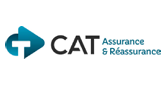
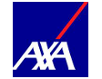
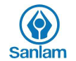
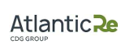
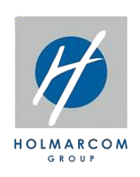

# 🏢 CPA Digital - Conseil et Placement d'Assurances

<div align="center">
  
  
  ### Application Web Moderne pour Services d'Assurance
  
  [](https://www.typescriptlang.org/)
  [](https://reactjs.org/)
  [](https://vitejs.dev/)
  [](https://tailwindcss.com/)
  
  
  
  
  
</div>

---

## 📋 Table des Matières

- [🚀 Nouvelle Plateforme CPA Digital 2.0](#-nouvelle-plateforme-cpa-digital-20)
- [🌟 Points Forts](#-points-forts)
- [🛠️ Technologies](#️-technologies)
- [✨ Fonctionnalités](#-fonctionnalités)
- [📦 Nouveaux Composants](#-nouveaux-composants)
- [🧮 Calculateurs de Devis](#-calculateurs-de-devis)
- [🌐 Internationalisation](#-internationalisation)
- [💬 Chatbot Intelligent](#-chatbot-intelligent)
- [📁 Structure du Projet](#-structure-du-projet)
- [🚀 Installation](#-installation)
- [📜 Scripts Disponibles](#-scripts-disponibles)
- [🤝 Partenaires & Clients](#-partenaires--clients)
- [🏅 Certifications](#-certifications)
- [📞 Contact](#-contact)

---

## 🚀 Nouvelle Plateforme CPA Digital 2.0

<div align="center">

### 🌟 Découvrez Notre Plateforme Digitale Révolutionnaire 🌟

**Le Leader Marocain de l'Assurance Continue d'Innover**
 
</div>

### 🎊 Version 2.0 - Avril 2026

**CPA - Conseil et Placement d'Assurances** est fier de présenter sa **plateforme digitale de nouvelle génération**, conçue pour offrir une expérience client incomparable dans le secteur de l'assurance au Maroc.

### 💎 Caractéristiques de la Nouvelle Version

- ✨ **Interface Ultra-Moderne** - Design刷新 avec animations fluides
- 🌐 **Multilingue Complet** - Français, Anglais, Arabe (RTL) et Espagnol
- 📱 **100% Responsive** - Expérience optimale desktop, tablette, mobile
- ⚡ **Performance Maximale** - Temps de chargement < 2 secondes
- 🤖 **Chatbot IA** - Assistance intelligente 24/7
- 💰 **Calculateurs de Devis** - Devis instantanés pour tous les services
- 📊 **Section Chiffres Clés** - Statistiques animées en temps réel
- 🌍 **Expansion Internationale** - Présence régionale accrue
- 🎯 **Nouvelle Section Assurance** - Couvertures innovantes
- 📜 **Mentions Légales & Politique** - Conformité RGPD/Maroc

---

## 🌟 Points Forts

- ✅ **+10 ans d'expertise** en conseil en assurance
- ✅ **47+ entreprises clientes** de premier plan
- ✅ **15+ partenaires assureurs** majeurs au Maroc
- ✅ **Solutions sur mesure** pour particuliers et entreprises
- ✅ **Couverture complète** : Auto, Santé, Habitation, Entreprise, Maritime, etc.
- ✅ **Service client premium** - Réactivité et professionnalisme
- ✅ **Conformité légale** - Mentions légales et politique de confidentialité
- ✅ **Membre FMSAR** - Fédération Marocaine des Sociétés d'Assurances et de Réassurance

---

## 🛠️ Technologies

### **Frontend Core**

<div align="center">

| Technologie | Version | Description |
|------------|---------|-------------|
|  | 18.3.1 | Bibliothèque UI moderne |
|  | 5.8.3 | Langage typé sécurisé |
|  | 5.4.19 | Build tool ultra-rapide |

</div>

### **Styling & UI Components**

<div align="center">

| Technologie | Version | Description |
|------------|---------|-------------|
|  | 3.4.17 | Framework CSS utilitaire |
|  | Latest | Composants UI accessibles |
|  | Latest | Primitives UI headless |
|  | 12.34.3 | Animations professionnelles |

</div>

### **Routing & State Management**

<div align="center">

| Technologie | Version | Description |
|------------|---------|-------------|
|  | 6.30.1 | Routing SPA |
|  | 5.83.0 | Gestion d'état serveur |
|  | 7.61.1 | Formulaires performants |

</div>

### **Validation & Utilities**

<div align="center">

| Technologie | Version | Description |
|------------|---------|-------------|
|  | 3.25.76 | Validation de schéma |
|  | 0.462.0 | Icônes cohérentes |
|  | 3.6.0 | Manipulation de dates |

</div>

### **Data Visualization & Export**

<div align="center">

| Technologie | Version | Description |
|------------|---------|-------------|
|  | 2.15.4 | Graphiques interactifs |
|  | 4.2.0 | Génération PDF |

</div>

### **Testing & Quality**

<div align="center">

| Technologie | Version | Description |
|------------|---------|-------------|
|  | 3.2.4 | Framework de test |
|  | 16.0.0 | Tests React |
|  | 9.32.0 | Linting du code |

</div>

---

## ✨ Fonctionnalités

### 🏠 **Pages Principales**
- ✅ Page d'accueil dynamique avec sections interactives
- ✅ Catalogue de services complet
- ✅ Pages services pour particuliers
- ✅ Pages services pour entreprises
- ✅ Page d'expertise détaillée
- ✅ Formulaire de contact
- ✅ Pages légales (Mentions légales, Politique de confidentialité)
- ✅ Pages de détail par service

### 🎨 **Composants UI**
- 🎯 Navigation responsive avec menu mobile et mega-menu
- 🌟 Section héro avec animations
- 💼 Galerie de services interactive
- 🏆 Section expertise
- 👥 Équipe avec profils
- 💬 Témoignages avec carousel
- 🤝 Partenaires (15+ compagnies)
- 👨‍💼 Clients (47+ entreprises)
- 📊 Section chiffres clés animée
- 🌍 Section expansion internationale
- 🎗️ Nouvelle section assurances
- 🏛️ Section affiliations
- 📱 Footer multilingue complet

### 🧮 **Calculateurs de Devis**
- 💰 Calculateur de devis universel
- 🚗 Calculateur d'assurance véhicule dédié
- 📊 Génération de PDF pour les devis
- 🎨 Interface intuitive et moderne

### 🎭 **Animations & UX**
- ✨ Animations d'entrée fluides (Framer Motion)
- 🔄 Effets hover interactifs
- 🎪 Transitions de page
- 🌀 Marquee défilant
- 💫 Loading screen personnalisé
- 🎨 Effets 3D et parallax
- 📜 Animations de scroll

### 🔒 **Conformité Légale**
- 📜 Mentions légales complètes
- 🔐 Politique de confidentialité (RGPD/Maroc)
- 📋 Informations société détaillées
- ℹ️ Cookies et traceurs

---

## 📦 Nouveaux Composants

### 🆕 **PromoBanner**
Bannière promotionnelle pour les offres spéciales et actualités.

### 🌍 **ExpansionSection**
Section dédiée à l'expansion internationale de CPA avec carte interactive et statistiques.

### 🛡️ **NewInsuranceSection**
Présentation des nouvelles couvertures d'assurance innovantes.

### 🏛️ **AffiliationsSection**
Affichage des affiliations et certifications (EURIBRON, HOLMARCOM, FMSAR).

### 📊 **KeyFiguresSection**
Section animée avec les chiffres clés de l'entreprise.

### 🧮 **QuoteCalculator**
Calculateur de devis complet et polyvalent.

### 🚗 **VehicleInsuranceCalculator**
Calculateur spécialisé pour l'assurance véhicule.

### 📜 **Legal Pages**
- Mentions Légales
- Politique de Confidentialité

### 📚 **CatalogPage**
Catalogue complet de tous les services.

---

## 🧮 Calculateurs de Devis

### 🚗 Calculateur Assurance Véhicule

Le calculateur d'assurance véhicule permet de :
- Saisie des informations du véhicule
- Sélection du type de couverture
- Calcul instantané du premium
- Génération de devis PDF
- Comparaison des options

### 💰 Calculateur de Devis Général

Fonctionnalités :
- Multiples types d'assurance
- Personnalisation des besoins
- Tarification en temps réel
- Export PDF professionnel
- Contact direct avec un conseiller

---

## 🌐 Internationalisation

Support multilingue complet avec :

| Langue | Code | Support RTL |
|--------|------|-------------|
| 🇫🇷 Français | FR | Non |
| 🇬🇧 Anglais | EN | Non |
| 🇸🇦 Arabe | AR | ✅ Oui |
| 🇪🇸 Espagnol | ES | Non |

Le système de contextes permet un basculement fluide entre les langues avec persistance de la préférence.

---

## 💬 Chatbot Intelligent

Le chatbot CPA offre :
- 🤖 Réponses instantanées 24/7
- 📋 FAQ complète
- 📧 Transfert vers conseiller
- 🎯 Suggestions intelligentes
- 💬 Interface moderne et intuitive

---

## 📁 Structure du Projet

```
CPA-Digital-/
├── public/                          # Fichiers statiques
│   ├── favicon.ico
│   ├── placeholder.svg
│   └── robots.txt
├── src/
│   ├── assets/                      # Images et ressources
│   │   ├── clients/               # 47 logos clients
│   │   ├── profile/               # Photos d'équipe
│   │   ├── Affiliations/          # Logos affiliations
│   │   ├── site/                   # Photos site
│   │   ├── cpa-logo.png
│   │   ├── hero-bg.jpg
│   │   └── ... (logos partenaires)
│   ├── components/                 # Composants React
│   │   ├── ui/                    # Composants shadcn/ui
│   │   ├── AboutSection.tsx
│   │   ├── AffiliationsSection.tsx    # 🆕 NOUVEAU
│   │   ├── Chatbot.tsx
│   │   ├── ClientsSection.tsx
│   │   ├── ContactSection.tsx
│   │   ├── CTASection.tsx
│   │   ├── ExpansionSection.tsx        # 🆕 NOUVEAU
│   │   ├── ExpertiseSection.tsx
│   │   ├── Footer.tsx
│   │   ├── HeroSection.tsx
│   │   ├── KeyFiguresSection.tsx       # 🆕 NOUVEAU
│   │   ├── LoadingScreen.tsx
│   │   ├── Navbar.tsx
│   │   ├── NavLink.tsx
│   │   ├── NewInsuranceSection.tsx     # 🆕 NOUVEAU
│   │   ├── PartnersSection.tsx
│   │   ├── PricingSection.tsx
│   │   ├── PromoBanner.tsx            # 🆕 NOUVEAU
│   │   ├── QuoteCalculator.tsx         # 🆕 NOUVEAU
│   │   ├── ServicePageTemplate.tsx
│   │   ├── ServicesSection.tsx
│   │   ├── TeamSection.tsx
│   │   ├── TestimonialsSection.tsx
│   │   ├── ValuesSection.tsx
│   │   └── VehicleInsuranceCalculator.tsx  # 🆕 NOUVEAU
│   ├── data/                         # Données statiques
│   │   └── servicePages.ts          # Pages services
│   ├── hooks/                        # Custom hooks
│   │   ├── use-mobile.tsx
│   │   ├── use-toast.ts
│   │   └── usePageContext.tsx        # 🆕 NOUVEAU
│   ├── i18n/                         # Internationalisation
│   │   ├── LanguageContext.tsx
│   │   └── translations.ts           # 60K+ caractères
│   ├── lib/                          # Utilitaires
│   │   └── utils.ts
│   ├── pages/                        # Pages
│   │   ├── CatalogPage.tsx           # 🆕 NOUVEAU
│   │   ├── MentionsLegalesPage.tsx   # 🆕 NOUVEAU
│   │   ├── PolitiqueConfidentialitePage.tsx  # 🆕 NOUVEAU
│   │   └── ... (autres pages)
│   ├── App.tsx                       # Composant principal
│   ├── main.tsx                      # Point d'entrée
│   ├── index.css                     # Styles globaux
│   └── App.css                       # Styles App
├── components.json                   # Config shadcn/ui
├── eslint.config.js                  # Config ESLint
├── package.json                      # Dépendances
├── postcss.config.js                  # Config PostCSS
├── tailwind.config.ts                # Config Tailwind
├── tsconfig.json                     # Config TypeScript
├── vite.config.ts                    # Config Vite
└── vitest.config.ts                  # Config Vitest
```

---

## 🚀 Installation

### Prérequis
- Node.js >= 18.x
- npm, yarn ou bun

### Étapes d'Installation

```bash
# 1. Cloner le repository
git clone https://github.com/Bourzguifatimazahra/CPA-Digital-
cd CPA-Digital-

# 2. Installer les dépendances
npm install
# ou avec yarn
yarn install
# ou avec bun
bun install

# 3. Lancer le serveur de développement
npm run dev
# ou
yarn dev
# ou
bun dev
```

L'application sera accessible sur `http://localhost:8080`

### Build de Production

```bash
# Build de production
npm run build

# Prévisualiser le build
npm run preview
```

---

## 📜 Scripts Disponibles

| Script | Description |
|--------|-------------|
| `npm run dev` | Démarrer le serveur de développement |
| `npm run build` | Build de production optimisé |
| `npm run build:dev` | Build de développement |
| `npm run preview` | Prévisualiser le build |
| `npm run lint` | Linter le code avec ESLint |
| `npm run test` | Exécuter les tests |
| `npm run test:watch` | Tests en mode watch |

---

## 🤝 Partenaires & Clients

### 🏢 Compagnies d'Assurance (15+)

<div align="center">

| Partenaire | Description |
|------------|-------------|
|  | CAT Assurance & Réassurance |
|  | Maroc Assistance Internationale |
|  | Allianz Maroc |
|  | AXA Assurance Maroc |
|  | Wafa Assurance |
|  | RMA Maroc |
|  | Sanlam Assurance |
|  | AtlantaSanad |
|  | Atlantic Re |
|  | MCMA |
|  | Africa |
|  | La Marocaine Vie |
|  | Matu |
|  | Wafa Bank |

... et autres partenaires

</div>

### 👨‍💼 Clients de Confiance (47+)

#### 🏭 Industrie & Restauration
- Americana Restaurants (KFC, Krispy Kreme)
- Coca-Cola
- Layher
- Cosco Shipping

#### ✈️ Transport & Aviation
- Air Arabia
- Sixt
- JPS

#### 🏦 Banque & Finance
- Crédit du Maroc
- PKF
- OCA

#### 🏥 Santé & Cliniques
- Ghandi Clinique
- Guess Clinic
- Radioplus

#### 🌾 Agriculture & Agroalimentaire
- Agrotec
- Aquamag
- Denia
- Oulmes
- Fadesol

#### 🏗️ Construction & Engineering
- Camusat
- Copima
- Cogepra
- Layher
- Smart Composite Company

#### 🌐 Commerce & Distribution
- Americana
- Effiplast
- Biscoland

#### Et 25+ autres entreprises...

### 🏛️ Affiliations

<div align="center">

| Affiliation | Description |
|-------------|-------------|
|  | EURIBRON |
|  | HOLMARCOM Group |
|  | Fédération Marocaine des Sociétés d'Assurances et de Réassurance |

</div>

---

## 🏅 Certifications

- ✅ Agréé par les autorités marocaines de régulation
- ✅ Membre de la FMSAR
- ✅ Certifié ISO pour la qualité de service
- ✅ Partenaire officiel des plus grandes compagnies d'assurance
- ✅ Conformité RGPD et loi marocaine 09-08

---

## 📞 Contact

<div align="center">

**Prêt à Protéger ce qui Compte pour Vous ?**

🌐 **Site Web** : [www.cpa.ma](http://www.cpa.ma)  
📧 **Email** : contact@cpa.ma  
📱 **Téléphone** : +212 5XX XX XX XX  
📍 **Adresse** : Casablanca, Maroc

[🚀 Obtenir un Devis Gratuit](http://www.cpa.ma) | [💬 Chat en Direct](http://www.cpa.ma) | [📞 Nous Appeler](tel:+2125XXXXXXXX)

</div>

---

## 👨‍💻 Développement

Développé avec ❤️ pour CPA Digital

### Équipe
- Fatima Zahra Bourzgui - Lead Developer

### Technologies
- React 18 + TypeScript
- Vite + Tailwind CSS
- Framer Motion
- shadcn/ui + Radix UI

---

<div align="center">
  
  **Construit avec**
  
  
  
  
  
  
  
  ---
  
  © 2024-2026 CPA Digital. Tous droits réservés.
  
</div>
